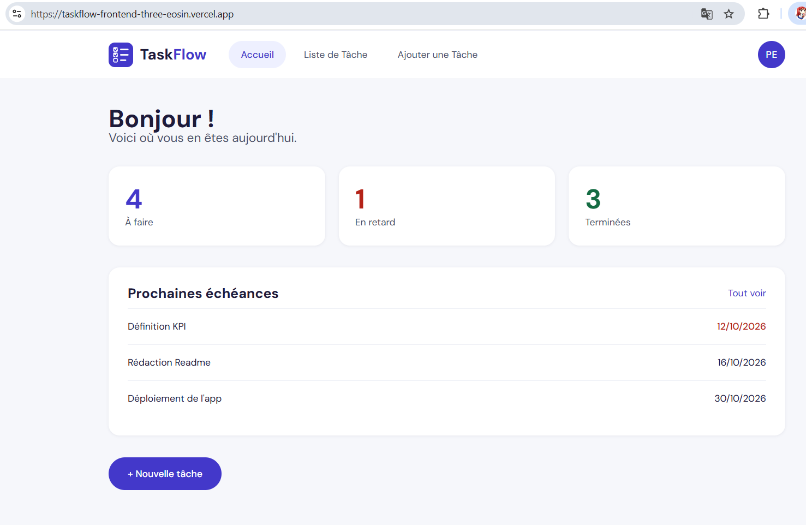
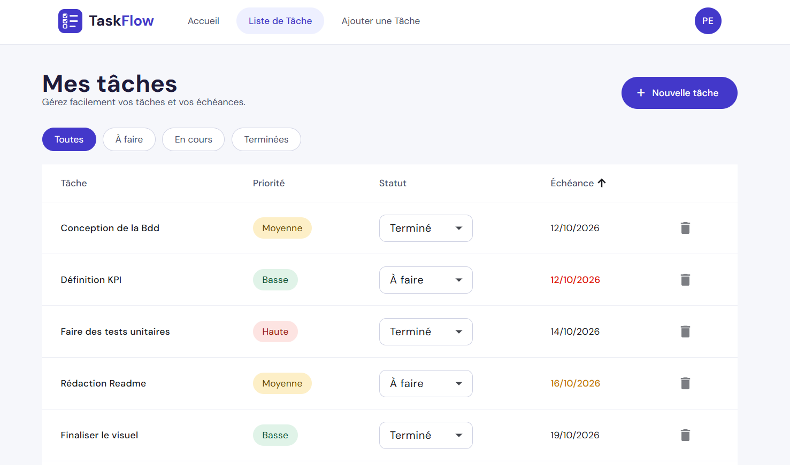
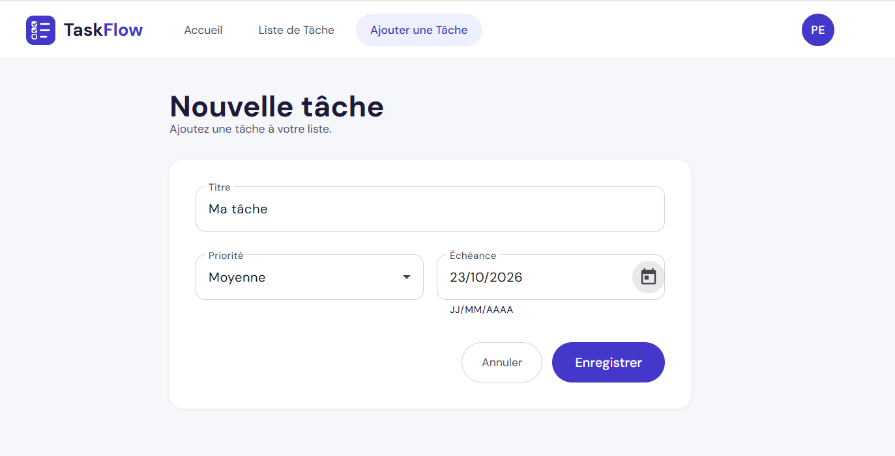
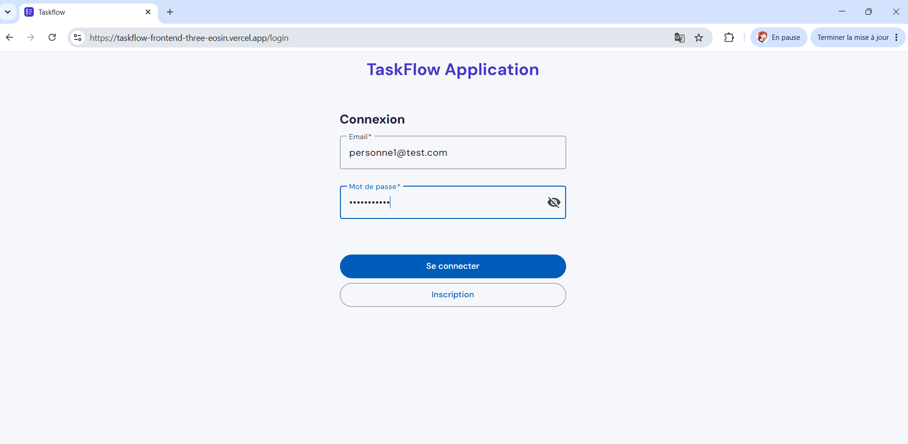

# TaskFlow

Application web de gestion de tâches en **Angular** (frontend) et **Spring Boot** (backend), avec authentification JWT.
Projet réalisé d'après une maquette, pour consolider mes compétences Full Stack Java.

🔗 **Démo en ligne** : https://taskflow-frontend-three-eosin.vercel.app/
🎥 **Vidéo de démonstration** : https://www.youtube.com/watch?v=W_Tl1lVULcU
⚙️ **Backend (Spring Boot)** : https://github.com/kericheouafa/taskflow-springboot

> Le premier chargement peut être lent si le serveur est en veille.

## Sommaire

- [Aperçu](#aperçu)
- [Fonctionnalités](#fonctionnalités)
- [Architecture](#architecture)
- [Technologies](#technologies)
- [Installation](#installation)
- [Tests](#tests)
- [Structure du frontend](#structure-du-frontend)
- [Points techniques](#points-techniques)
- [Pistes d'amélioration](#pistes-damélioration)
- [Auteure](#auteure)

## Aperçu

| Accueil | Liste des tâches |
|---|---|
|  |  |

| Ajout d'une tâche | Connexion |
|---|---|
|  |  |

## Fonctionnalités

- **Authentification** : inscription, connexion (JWT), déconnexion, déconnexion automatique après inactivité
- **Gestion des tâches** : création (titre, priorité, échéance), suppression avec confirmation, changement de statut (À faire, En cours, Terminé)
- **Liste** : tri des colonnes, filtres par statut, pastilles de priorité (Haute, Moyenne, Basse)
- **Échéances** : date colorée selon l'urgence (rouge : en retard ou dans 2 jours, orange : de 3 à 5 jours)
- **Accueil** : nombre de tâches à faire, en retard et terminées, et les 3 prochaines échéances
- **Interface** : design cohérent (palette, typographie DM Sans), barre de navigation avec espace personnel

## Architecture

```
Navigateur ──► Frontend Angular (Vercel) ──► API REST Spring Boot (Render) ──► Base de données
                                         JWT      JPA / Hibernate
```

## Technologies

| Partie | Outils |
|---|---|
| Frontend | Angular 21, TypeScript, Angular Material, RxJS |
| Backend | Java, Spring Boot, Spring Data JPA / Hibernate, API REST |
| Base de données | PostgreSQL |
| Tests | Vitest (Angular), JUnit 5 et Mockito (backend) |
| Outils et déploiement | Git, GitHub, Docker, Vercel (frontend), Render (backend) |

## Installation

### Prérequis

- Node.js 24 et npm
- Angular CLI (`npm install -g @angular/cli`)
- Java 25 (Temurin) et Maven
- PostgreSQL, avec une base nommée `taskflow_db` (port 5432 par défaut)

### Backend

Voir le dépôt backend. Créez d'abord la base PostgreSQL `taskflow_db`, renseignez l'utilisateur et le mot de passe dans `application.properties` (`spring.datasource.username` et `spring.datasource.password`), puis :

```bash
mvn spring-boot:run
```

En production (Render), la connexion à la base est fournie par des variables d'environnement.

Le serveur démarre sur `http://localhost:8080`.

### Frontend

```bash
git clone https://github.com/kericheouafa/taskflow-frontend
cd taskflow-frontend
npm install
ng serve
```

L'application est disponible sur `http://localhost:4200`.
Le backend doit tourner pour que les données s'affichent. Créez un compte depuis la page d'inscription, puis connectez-vous.

## Tests

```bash
ng test
```

Les tests unitaires du frontend couvrent notamment :

- le **calcul de l'urgence des échéances** : cas limites (aujourd'hui, 2, 3, 5 et 6 jours), tâche terminée, tâche sans date, tâche sans statut, avec une date du jour simulée pour des résultats stables ;
- la **connexion** : succès, identifiants incorrects, serveur injoignable ;
- l'**ajout d'une tâche** : format de la date envoyée, redirection, erreurs de validation du serveur.

Le service Angular est remplacé par un faux dans les tests : aucun appel réseau réel.

Le backend dispose de 25 tests unitaires (JUnit 5, Mockito, MockMvc) : service JWT, service des tâches et contrôleur d'authentification. Voir le [dépôt backend](https://github.com/kericheouafa/taskflow-springboot).

## Structure du frontend

```
src/app/
├── accueil/     tableau de bord (statistiques, prochaines échéances)
├── taches/      liste, tri, filtres, changement de statut
├── ajouter/     formulaire de création d'une tâche
├── login/       connexion
├── navbar/      navigation et menu utilisateur
└── services/    authentification et gestion de l'inactivité
```

## Points techniques

- **Date décalée d'un jour** : la date choisie dans le sélecteur était envoyée en UTC par le navigateur (le 20 devenait le 19 à 22 h). Corrigé en envoyant la date au format `yyyy-MM-dd`, avec un test qui protège cette règle.
- **Calcul de l'urgence** : la date du jour est simulée dans les tests pour qu'ils donnent le même résultat chaque jour.
- **Données absentes** : les méthodes tolèrent une tâche sans date ou sans statut (opérateur `?.`), vérifié par des tests.

## Pistes d'amélioration

- Champ description pour les tâches
- Modification du titre, de la priorité et de l'échéance d'une tâche existante

## Auteure

**Ouafa Keriche** — Ingénieure systèmes d'information, développeuse Full Stack (Java, Spring Boot, Angular).
GitHub : [kericheouafa](https://github.com/kericheouafa)
